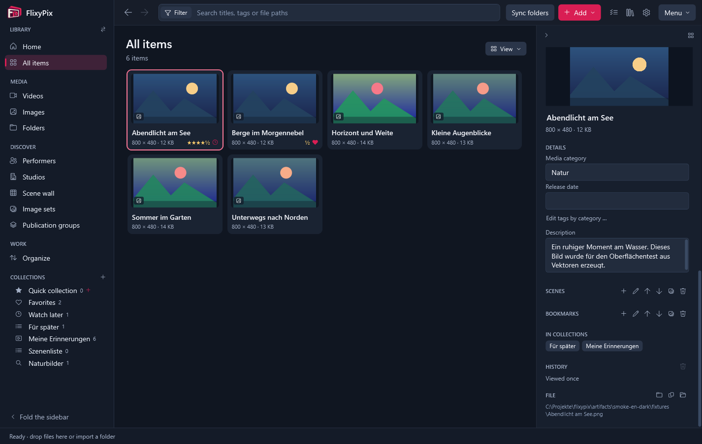

# FlixyPix

FlixyPix is a private media library for Windows, made for large collections of videos, pictures and
audio. Everything stays on your computer: no account, no server, and your files stay where they are.
It suits any collection and is also built for adult ones.

It began as an independent successor for people still using EazyFlixPix 4.8.4, a program that is no
longer maintained, and it can take over those catalogs.



## What you can do with it

- **Bring your collection in.** Add files and folders or watch media folders. FlixyPix never moves
  your files; it finds moved or renamed ones again and tells you what is missing.
- **Put it in order.** Tag with one hand in the tag mode, rate, describe, and build collections. Queues
  such as "without tags" or "unrated" take you through what is left, one item at a time.
- **Find things again.** Walk through your folders, narrow the view with filters, or use the advanced
  search with its query language. Duplicate detection, filename parsers and tagging rules help with
  the rest.
- **Watch and look.** Play video and audio through mpv with scenes and bookmarks, and view images with
  zoom, rotation, slideshows and ZIP/RAR archives.
- **Make something from it.** Create thumbnails, clips, GIFs, joined videos and conversions through
  FFmpeg in a job queue.
- **Keep it safe.** Use several libraries, check and repair them, schedule backups, import and export
  (JSON, CSV, NFO, M3U, tag packages).

The interface speaks English, German, French, Spanish, Italian, Brazilian Portuguese, Dutch, Polish,
Japanese and Russian.

## Adult collections

FlixyPix treats these as a normal use case:

- **Organize:** galleries of performers and studios with a page per entry, scenes and bookmarks, a
  scene wall, import from Stash (Catalog button in the top bar → Import and export), and an optional
  Adult Content Pack with 62 genres in ten languages.
- **Privacy:** a boss key that hides everything at once, a lock (after inactivity, on minimizing or
  with Windows), blurred pictures, optional encryption of the catalog, and no online services.

FlixyPix ships no adult media and no lists of people. You find the pack in the directory, or on the
home page while the library is empty.

## Download and start

You need Windows 10 or 11, 64-bit.

1. Download `FlixyPix-<version>-win-x64.zip` from the
   [releases](https://github.com/Kirmalix/flixypix/releases) and unpack it into a folder of your
   choice.
2. Start `FlixyPix.exe`. The .NET runtime, FFmpeg, ffprobe and mpv are included; keep the `tools`
   folder beside the program.

Your catalog and settings live in a `Data` folder beside the program. To keep them in your Windows
profile instead, switch under Settings → Storage. The download is not signed yet, so Windows
SmartScreen may ask for confirmation on the first start.

**Before you update:** versions before 1.0 may change the catalog format, and the
[release notes](CHANGELOG.md) say when. FlixyPix keeps a copy of the catalog before it converts one,
but an older version may not open a converted library, so back up your catalog and media files first.

## Coming from EazyFlixPix

Add → Import library from EazyFlixPix 4 (also under Catalog → Legacy data) imports an EazyFlixPix
catalog (`.sdf`) into a new library. The import works on a copy and never changes the original catalog.

Reading the old catalog needs Microsoft SQL Server Compact 4.0, which FlixyPix does not ship. FlixyPix
uses the copy inside an existing EazyFlixPix installation. Without one, install
[Microsoft SQL Server Compact 4.0 SP1 (x86)](https://www.microsoft.com/download/details.aspx?id=30709)
first. FlixyPix tells you if neither is found.

With an EazyFlixPix installation, the Adult Content Pack also offers that installation's performer and
studio lists, read from its program file.

Online providers, live TV and other online services of EazyFlixPix are not part of FlixyPix.

## Help with translations

The translations were produced and reviewed with AI assistance, not by native speakers, so corrections
are very welcome. All texts are written in English in the code; the other languages live in
`src/FlixyPix.Core/Languages/<code>.json`. See [CONTRIBUTING.md](CONTRIBUTING.md).

## Who makes this

FlixyPix is maintained by one person in their spare time, without support commitments. It is developed
with the help of AI tools (Claude); every change is reviewed and tested before it is merged.

## Building from source

You need Windows 10 or 11 (x64), PowerShell 5.1, Python 3.11 or later and Git. The scripts download a
pinned .NET SDK, FFmpeg and mpv into `.tools` and verify their hashes; they change neither the system
nor `PATH`.

```powershell
.\scripts\bootstrap.ps1
.\scripts\build.ps1
```

`build.ps1` builds the solution, runs the .NET and Python tests and the translation check, publishes
the portable application to `artifacts\portable-FlixyPix` and runs a UI smoke test on a hidden desktop.
Slow tests (large catalogs, time budgets) run only with `-FullTests`; `-SkipTests`, `-SkipUiSmoke` and
`-NoMediaTools` shorten the run.

| Folder | Content |
|---|---|
| `src/FlixyPix.Core` | Catalog (SQLite), search, tags, media, settings, import of old catalogs, translations |
| `src/FlixyPix.Desktop` | WPF application |
| `src/FlixyPix.MediaTools` | FFmpeg, ffprobe, mpv, thumbnails, job queue |
| `src/FlixyPix.Imaging`, `src/FlixyPix.Archives` | Image decoders, ZIP and RAR image archives |
| `src/FlixyPix.LegacyExporter` | Reads EazyFlixPix catalogs (.NET Framework, x86) |
| `src/FlixyPix.CatalogAudit` | Command-line check of a catalog import |
| `tests/` | .NET tests per project |
| `scripts/` | Bootstrap, build, translation checks, release packaging |
| `assets/` | Logo and tag packages (adult genres in ten languages) |

## License

Copyright (C) 2026 The FlixyPix contributors.

FlixyPix is free software under the [GNU General Public License v3.0 or later](LICENSE). The
EazyFlixPix catalog reader in `src/FlixyPix.LegacyExporter` is also available under the
[MIT License](src/FlixyPix.LegacyExporter/LICENSE). Bundled components keep their own licenses; see
[THIRD-PARTY-NOTICES.md](THIRD-PARTY-NOTICES.md).

FlixyPix is an independent project. It is not affiliated with or endorsed by the authors of EazyFlixPix
and contains none of its code, texts or graphics. EazyFlixPix was studied only to read its catalog
format.
