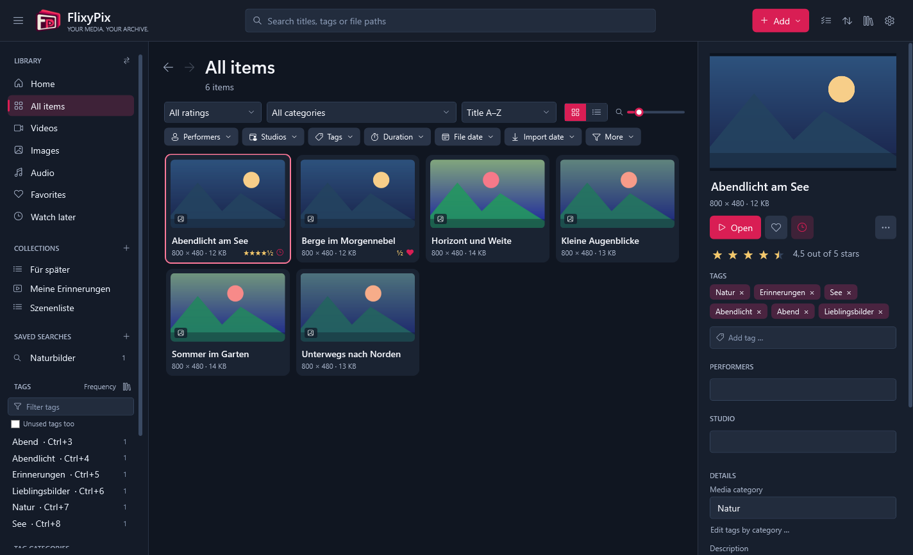

# FlixyPix

FlixyPix is a local media library for Windows. It catalogs videos, images and audio where they
already are, and lets you tag, rate, describe, search and play them. Everything stays on your
computer: no account, no server, no online services.

FlixyPix started as an independent successor for users of EazyFlixPix 4.8.4, a program that is
no longer maintained, and can take over its catalogs.



> **Status: preview (0.x).** FlixyPix is usable but young. Formats and behavior may still change
> between previews, and there is no installer or code signing yet. Back up your catalog
> (Catalog → Database management → Backup) before you update.

## Features

- **Catalog:** import files and folders or watch media folders; files are never moved. Moved or
  renamed files are found again, missing ones are reported.
- **Organize:** tags with categories and tag images, ratings, descriptions, collections, saved
  searches, a directory of performers, studios and other entities, filename parsers and tagging
  rules, duplicate detection.
- **Search:** quick search, filters in the sidebar and an advanced search with a query language.
- **Play and view:** video and audio through mpv with scenes and bookmarks; an image viewer with
  zoom, rotation, slideshow and ZIP/RAR image archives.
- **Tools:** thumbnails, clips, GIFs, joined videos and conversions through FFmpeg in a job queue.
- **Database management:** several libraries, check and repair, scheduled backups, import and
  export (JSON, CSV, NFO, M3U, tag packages), optional encryption of the catalog.
- **Languages:** English, German, French, Spanish, Italian, Brazilian Portuguese, Dutch, Polish,
  Japanese and Russian.

## Download and start

Requirements: Windows 10 or 11, 64-bit.

1. Download `FlixyPix-<version>-win-x64.zip` from the
   [releases](https://github.com/Kirmalix/flixypix/releases) and unpack it into a folder of your
   choice.
2. Start `FlixyPix.exe`. The .NET runtime, FFmpeg, ffprobe and mpv are included; keep the `tools`
   folder beside the program.

The catalog and settings are stored under `%LOCALAPPDATA%\FlixyPix`. The download is not signed
yet, so Windows SmartScreen may ask for confirmation on the first start.

## Importing from EazyFlixPix

Add → Import library from EazyFlixPix 4.8.4 (also under Catalog → Database management → Legacy
data) imports an EazyFlixPix catalog (`.sdf`) into a new library. The import works on a copy and
never changes the original catalog.

Reading the old catalog needs Microsoft SQL Server Compact 4.0, which FlixyPix does not ship.
FlixyPix uses the copy inside an existing EazyFlixPix installation. Without one, install
[Microsoft SQL Server Compact 4.0 SP1 (x86)](https://www.microsoft.com/download/details.aspx?id=30709)
first. FlixyPix tells you if neither is found.

The optional Adult Content Pack (directory, or the empty home page) adds 62 genres in ten
languages. With an EazyFlixPix installation it also offers that installation's performer and
studio lists, read from its program file; FlixyPix does not ship these lists.

Online providers, live TV and other online services of EazyFlixPix are not part of FlixyPix.

## Building from source

Requirements: Windows 10 or 11 (x64), PowerShell 5.1, Python 3.11 or later, Git. The scripts
download a pinned .NET SDK, FFmpeg and mpv into `.tools` and verify their hashes; they change
neither the system nor `PATH`.

```powershell
.\scripts\bootstrap.ps1
.\scripts\build.ps1
```

`build.ps1` builds the solution, runs the .NET and Python tests and the translation check,
publishes the portable application to `artifacts\portable-FlixyPix` and runs a UI smoke test on a
hidden desktop. `-SkipTests`, `-SkipUiSmoke` and `-NoMediaTools` shorten the run.

| Folder | Content |
|---|---|
| `src/FlixyPix.Core` | Catalog (SQLite), search, tags, media, settings, import of old catalogs, translations |
| `src/FlixyPix.Desktop` | WPF application |
| `src/FlixyPix.MediaTools` | FFmpeg, ffprobe, mpv, thumbnails, job queue |
| `src/FlixyPix.Imaging`, `src/FlixyPix.Archives` | Image decoders, ZIP and RAR image archives |
| `src/FlixyPix.LegacyExporter` | Reads EazyFlixPix catalogs (.NET Framework, x86) |
| `src/FlixyPix.CatalogAudit` | Command-line check of a catalog import |
| `tests/` | .NET tests per project |
| `scripts/` | Bootstrap, build, translation checks, release packaging |
| `assets/` | Logo and tag packages (adult genres in ten languages) |

## Translations

All texts are written in English in the code; the other languages live in
`src/FlixyPix.Core/Languages/<code>.json`. The translations were produced and reviewed with AI
assistance, not by native speakers. Corrections are very welcome; see
[CONTRIBUTING.md](CONTRIBUTING.md).

## License

Copyright (C) 2026 The FlixyPix contributors.

FlixyPix is free software under the [GNU General Public License v3.0 or later](LICENSE). The
EazyFlixPix catalog reader in `src/FlixyPix.LegacyExporter` is also available under the
[MIT License](src/FlixyPix.LegacyExporter/LICENSE). Bundled components keep their own licenses;
see [THIRD-PARTY-NOTICES.md](THIRD-PARTY-NOTICES.md).

FlixyPix is an independent project. It is not affiliated with or endorsed by the authors of
EazyFlixPix and contains none of its code, texts or graphics. EazyFlixPix was studied only to
read its catalog format.

FlixyPix is developed with the help of AI tools (Claude); every change is reviewed and tested
before it is merged. It is maintained by one person in their spare time, without support
commitments.
